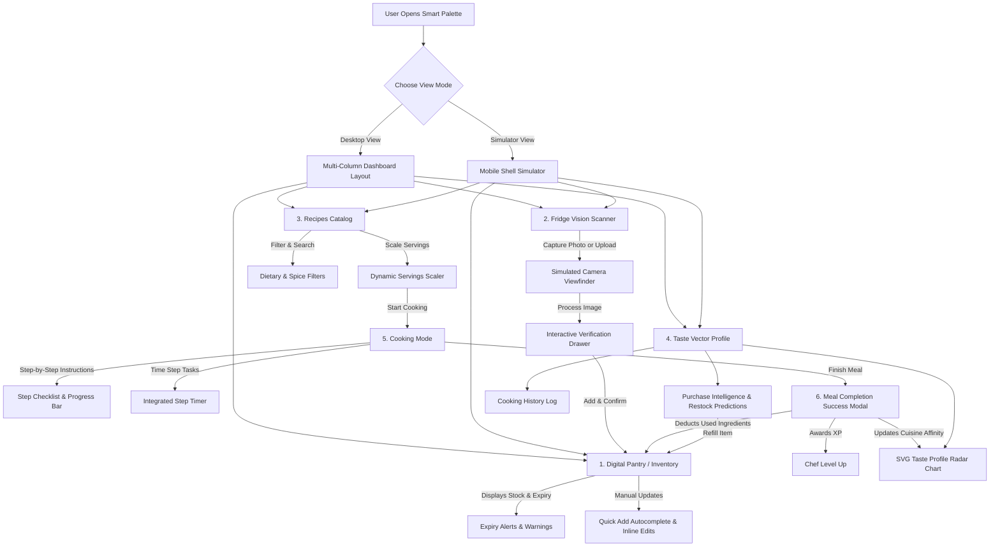

# Smart Palette — Component Explanation Guide

Smart Palette is an AI-powered fridge-to-plate culinary assistant that helps users reduce food waste, manage their kitchen inventory dynamically, and cook recipes tailored to what is currently available in their pantry. 

Below is an interactive flow diagram showing how a user interacts with the app, followed by a detailed breakdown of each component and its role in the user journey.

---

## 🗺️ User Journey & Component Flow

---

## 🧩 Detailed Component Explanations

### 1. Layout & View Modes (`viewMode` Toggle)
* **What it does:** Allows the user to toggle between a widescreen **Desktop View** (multi-column dashboard) and a **Simulator View** (a virtual mobile phone frame).
* **User Context:** 
  * In *Desktop View*, the user has a bird's-eye view of everything: the pantry is on the left, and the recipe catalog or taste profile tabs are on the right.
  * In *Simulator View*, the user experiences the app as if it were on a smartphone, switching between tabs (Cook Recipes, Pantry, Preferences) via a bottom/top navigation bar.

---

### 2. Digital Pantry / Inventory Manager
* **What it does:** Displays the user's current food stock, classified into categories like Produce, Dairy, Meat, Pantry, and Condiments.
* **Key Features:**
  * **Expiry Alerts (`expiringPantryItems`):** Highlights items expiring within 48 hours (e.g., "Chicken Breast expires in 12h") in a warning box at the top.
  * **Category Filter Pills:** Let users filter ingredients quickly by category (e.g., viewing only Produce or Dairy).
  * **Inline Editing & Deletion:** Users can edit ingredient quantities inline or delete ingredients when they run out or are discarded.
  * **Quick Manual Entry (`autocompleteSuggestions`):** A text input form featuring autocompletion to manually search for and add missing items (like Olive Oil or Garlic) with default units.
* **User Context:** The user uses this component to see what they have in stock, check what needs to be cooked immediately before it goes bad, and manually correct ingredients.

---

### 3. Fridge Vision Scanner (Camera Viewfinder Modal)
* **What it does:** Simulates a smartphone camera scanning the inside of a refrigerator to automatically detect ingredients.
* **Key Features:**
  * **Viewfinder Frame Overlay:** Prompts the user to align shelves.
  * **Flash Toggle:** Simulates turning the camera flash on or off for dark fridges.
  * **Tips Modal (`showTips`):** Guides the user on how to get the best scan (e.g., keeping the door open fully, avoiding overlapping ingredients).
  * **Mock Processing Actions:** Supports taking a photo (shutter button with a laser scan animation) or uploading an image from a local gallery (with an analysis loading screen).
* **User Context:** A user clicks "Scan Fridge Photo," snaps a picture of their open refrigerator, and relies on simulated vision AI (modeled on Llama-3.2-Vision) to extract and inventory their food items without manual typing.

---

### 4. Interactive Verification Drawer (`showVerify` Drawer)
* **What it does:** Serves as a validation stage between camera detection and database updates.
* **Key Features:**
  * **Confidence Indicators:** Flags ingredients that had a lower vision model confidence score (e.g., Cheddar Cheese at 84% confidence) with an warning sign.
  * **Quantity & Name Verification:** Allows users to rename detected items, tweak quantities (using `+` and `-` steppers), or delete false positives.
* **User Context:** After scanning, the user reviews the detected ingredients to ensure accuracy, adjusts any incorrect quantities, and confirms the items to add them to their digital pantry.

---

### 5. Recipes Catalog
* **What it does:** Dynamically displays recipes that match the user's current pantry stock.
* **Key Features:**
  * **Match Type Badges:**
    * **Zero-Waste:** Recipes that require 100% ingredients that the user already has in stock.
    * **Quick Run:** Recipes that require some missing items (e.g., missing Penne Pasta).
  * **Substitution Suggestions (`substitutions`):** Suggests smart kitchen swaps for missing ingredients (e.g., using "Whole Milk + Butter" in place of heavy cream).
  * **Search & Filters:** Users can search for specific words or filter by Dietary Locks (Vegan, Gluten-Free) or Spice Limit Tolerance.
  * **Servings Scaler (`servings`):** An interactive scaler that adjusts the required ingredient amounts dynamically based on chosen servings.
* **User Context:** The user scans their fridge, filters out spicy foods or gluten, reviews recipe matches, selects the number of servings they want to cook, and launches the cooking guide.

---

### 6. Cook Mode (Step-by-Step Cooking Interface)
* **What it does:** Guides the user page-by-page through the instructions of the chosen recipe.
* **Key Features:**
  * **Step Checklist:** Shows the exact scaled ingredients and kitchen tools required for the active instruction step.
  * **Progress Bar:** Visually tracks how far along the user is (e.g., Step 2/5).
  * **Step Timer Widget:** An interactive timer (countdown and controls) that users can start, pause, and reset to time tasks like boiling pasta or sautéing spinach.
* **User Context:** The user places their phone or laptop on the kitchen counter, checks off ingredients as they add them to the pan, and uses the built-in timer to monitor cooking steps.

---

### 7. Meal Completion Success Modal (`showSuccessModal`)
* **What it does:** A congratulatory pop-up indicating that the meal has been completed.
* **Key Features:**
  * **Automatic Stock Deduction:** Calculates the scaled ingredients used and subtracts them from the digital pantry (fully depleting and removing them if necessary).
  * **Gamified Rewards:** Awards the user Cooking Experience Points (XP) which contribute to their Chef Level.
  * **Waste Risk Impact:** Summarizes the items used and reports a decrease in waste risk.
* **User Context:** When the user clicks "Finish & Complete Meal," they see their level progression, get a breakdown of what was subtracted from their pantry, and return to the main dashboard.

---

### 8. Profile & Taste Vector Preferences (Preferences Tab)
* **What it does:** Displays user analytics, historical logs, and custom locks.
* **Key Features:**
  * **Taste Vector Profile (SVG Radar Chart):** A dynamic pentagon chart tracking affinity scores for Italian, Mexican, Asian, Western, and Indian cuisines. Cooking meals shifts these scores dynamically (e.g., cooking pasta increases the Italian score).
  * **Dietary Locks:** Global preference buttons (Vegan, Gluten-Free) that immediately filter the recipe catalog.
  * **Purchase Intelligence:** Lists items that are consumed frequently (e.g., Eggs every 4 days) and prompts the user to restock them with a single click "Refill" button.
  * **Cooking History:** A scrollable log of all prepared dishes showing dates and XP earned.
* **User Context:** The user opens this tab to see how their taste profile has shifted, toggle dietary preferences, look at past cooked meals, and quickly restock staples they buy frequently.
